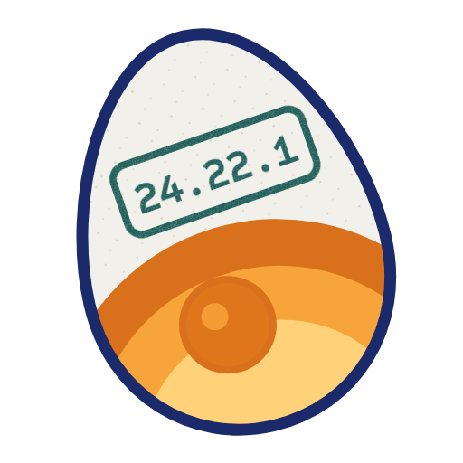

<p align="center"></p>

# lotstamp

**Version strings said 6 of 8 AI coding tools were exposed to Node2Shell. The decoder inside them said 0.**

lotstamp reads the Brotli decoder compiled into every Node, Bun, Electron, Python and system library copy on your machine (or in a build artifact) and tells you whether the code you actually run has the CVE-2026-111497 fix, and who has to ship it: you, the app vendor, or your distro. It never executes what it reads.

[Landing page](https://blackman99.github.io/lotstamp/) · [Docs](https://blackman99.github.io/lotstamp/docs/) · [Releases](https://github.com/Blackman99/lotstamp/releases)

## Why

Node2Shell (CVE-2026-111497) is an out-of-bounds write in the Brotli decoder. Node 22.23.4 / 24.22.1 / 26.12.1, Bun 1.4.4 and Brotli 1.0.10 / 1.1.1 / 1.2.1 fix it. But `node -v` answers the wrong question:

- **Every Bun binary contains a `node-v26.3.0` headers URL** (Bun's Node-compat level). A version-string check calls Claude Code and OpenCode "Node 26.3.0, vulnerable". They run Bun 1.4.4, which is fixed.
- **Electron builds Node against Chromium's Brotli.** Cursor, Windsurf, VS Code and Kiro report Node 24.19–24.21, yet Chromium 148 already carries the fix.
- **Debian's `/usr/bin/node` links the system libbrotlidec**, so the Node binary itself proves nothing; the shared library is what runs.

## The fingerprint

The fix adds one new decoder error, `BROTLI_DECODER_ERROR_FORMAT_BLOCK_SWITCH (-17)`, and its name is compiled into the decoder's error-string table. Pre-fix decoders have 16 `FORMAT` names; fixed ones have 17. Debian's 1.0.9 and 1.1.0 backports add it too. When a package database answers (dpkg), its version wins.

## Install

```sh
curl -fsSL https://blackman99.github.io/lotstamp/install.sh | sh   # Linux/macOS, checksum checked
go install github.com/Blackman99/lotstamp/cmd/lotstamp@latest
```
Windows and other targets: binaries on the [release page](https://github.com/Blackman99/lotstamp/releases).

## Demo

Debian 13 (the build box), with official Node 24.22.0 and 24.22.1 installed under nvm. Real output, nothing edited:

```
$ lotstamp
lotstamp  CVE-2026-111497 · Node2Shell/HTTP2Shell (Brotli decoder)
read 15 files in 700ms · this machine · nothing was executed

BEHIND      node  ~/.nvm/versions/node/v24.22.0/bin/node
            Node 24.22.0
            decoder  pre-fix code: 16 decoder error names, no BLOCK_SWITCH
                fix  nvm install 24 && nvm alias default 24  (Node 24.22.1 or newer on the 24.x line)  · who: you

BEHIND      Brotli decoder library libbrotlidec.so.1.1.0  /usr/lib/x86_64-linux-gnu/libbrotlidec.so.1.1.0
            system libbrotli1 1.1.0-2+b7
            decoder  pre-fix code: 16 decoder error names, no BLOCK_SWITCH
            used by  /usr/bin/node (Node 20.19.2)  via libnode.so.115 → libbrotlidec.so.1
                fix  sudo apt update && sudo apt install --only-upgrade libbrotli1  (fixed in 1.1.0-2+deb13u1, DSA-6582-1)  · who: you

BEHIND      bun 1.4.2 (package)  /usr/local/lib/pnpm/5/.pnpm/bun@1.4.2/node_modules/bun/bin/bun.exe
            Bun 1.4.2
            decoder  pre-fix code: 16 decoder error names, no BLOCK_SWITCH
               also  bunx.exe (same package, same reading)
            version  contains a Node 26.3.0 headers URL
                but  that is Bun's Node-compat level; the runtime is Bun 1.4.2
                fix  pnpm add -g bun@latest  (Bun 1.4.4 or newer has the fix)  · who: you

FIXED       node  ~/.nvm/versions/node/v24.22.1/bin/node
            Node 24.22.1
            decoder  fixed code: BLOCK_SWITCH present (17 decoder error names)

total decoders: 3 behind · 1 fixed   (9 more files have no decoder; --all lists them)
3 of the behind ones are yours to fix now (who: you)
```

Exit code 3 means something is behind; 0 means every decoder found carries the fix.

## In CI

```yaml
- uses: Blackman99/lotstamp@v0
  with:
    paths: dist/            # bun build --compile output, Node SEA, electron-builder out/
    fail-on: behind
```

## Verdicts

| grade | meaning |
|---|---|
| FIXED | fix marker present, or the distro package is at/above the fixed version |
| BEHIND | pre-fix decoder code and nothing says it was backported |
| NO-FIX-LINE | behind on a Node line that gets no release (25, 23, 20...) |
| UNKNOWN | packed payload (AppImage) or conflicting evidence |

## What was tested, and what wasn't

- Tested on real bytes downloaded 2026-10-24: official Node 20.19.5 / 22.23.4 / 24.22.0 / 24.22.1, Bun 1.4.3 / 1.4.4, Debian 12 and 13 libbrotli1 debs (before and after DSA-6582-1 / DLA-4855-1), PyPI brotli 1.2.0, and Linux x64 builds of Claude Code 2.1.310, OpenCode 1.19.4, Copilot CLI, Cursor agent CLI, Cursor 3.27.12, Windsurf 1.126.0, VS Code 1.143.1, Kiro 1.4.26.
- Their main runtimes all read FIXED. One helper bundled with VS Code, `vsce-sign` (a .NET 9.0.9 single-file app that verifies extension signatures), carries a pre-fix decoder in its statically linked `System.IO.Compression.Native`. Reading the Linux x64 bundle and the public .NET source, we found no path for untrusted Brotli data to reach it: `System.IO.Compression.Brotli.dll`, the only managed caller, is not in the bundle, and the certificate/CRL downloader does not enable HTTP decompression. lotstamp still grades it BEHIND (it grades code, not reachability); details in the [FAQ](https://blackman99.github.io/lotstamp/docs/#faq). macOS and Windows builds of `vsce-sign` are not inspected yet.
- **Not tested on real macOS or Windows machines yet.** Mach-O and PE parsing is covered by CI on macOS and Windows runners, but app-bundle discovery there has only seen synthetic layouts.

## Roadmap

- v0.2: Ubuntu/RHEL/Alpine package databases, Homebrew, container images without a daemon.
- v0.3: more embedded-library advisories (zlib, libuv, OpenSSL inside runtimes) using the same marker approach.

## License

MIT
